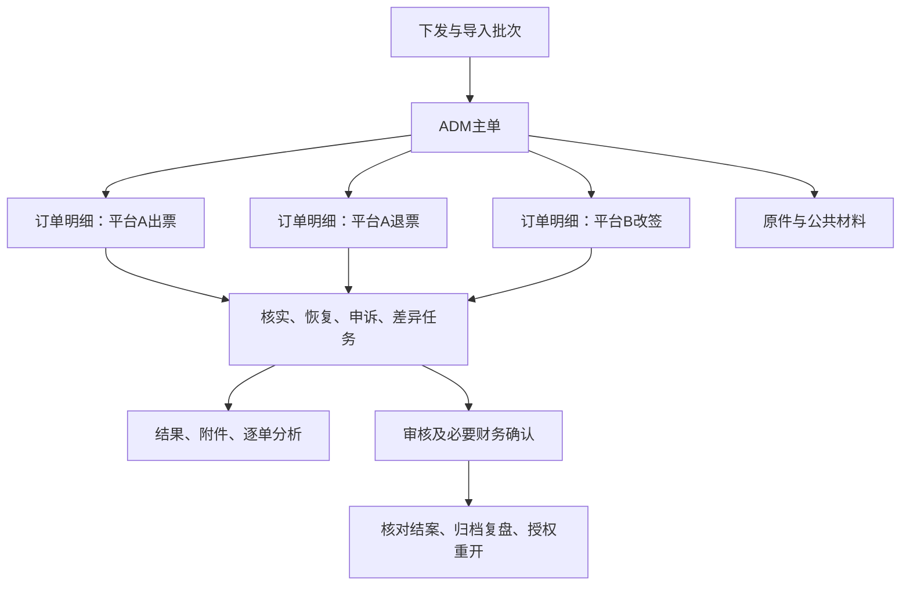

# 数据中台 ADM 管理中心 PRD V1

| 项目 | 内容 |
| --- | --- |
| 版本与日期 | V1.0，2026-10-24，Asia/Shanghai |
| 文档状态 | 开发中：首版核心流程已实现，待部署及业务验收；完整PRD并未全部交付，见[实现交接](../development/adm-management-center-v1.md) |
| 产品目标 | 融合 ERP Java ADM 管理和独立 Python ADM 工作台，在数据中台完成建档、核实、分工、处理、审核、财务跟进和归档 |
| 本次授权 | 用户已追加授权按PRD开发；不包含生产DDL执行、真实迁移、部署或外部通知 |
| 实际角色 | PRD由明策主会话编写；开发和验证协作记录见工作流，最新规则为主代理优先、最多一个活动子代理、禁止再派生 |
| 难度与节奏 | 跨系统、金额、附件和流程迁移难度较高；用户希望先开发再优化，具体上线日期未给定；分批交付完整首版 |
| 核对基线 | `flight-manage-api@88ac881c9`、`adm@b0e4f02`、`data_report@e39a462` |

## 1. 产品结论、范围和依据

在 `data_report` 建立 ADM 管理中心，以“供应下发的一张 ADM 主单”为管理对象，下设可独立处理的订单明细，支持同单多平台、多订单、多客票及出票、退票、改签业务。导入批次管理一次下发的多个文件和多张 ADM，不把批次当成 ADM。

统一迁移两套系统的业务能力、字段、历史和核验规则。前端使用中台 Vue，后端使用中台 Flask 领域模块；Java 业务规则按本 PRD 映射实现，Python 有依据且适用的逻辑提取复用。所有正式状态进入持久业务库，从中台完成日常工作。

本方案定义六条闭环：下发数据有去向、订单核实有依据、人员处理有结果、附件证据可追溯、财务事项有确认、结案后可复盘和重开。不能仅因锁单、填写备注、点击按钮或匹配到差异记录就认定整单完成。

| 依据等级 | 内容 | 使用方式 |
| --- | --- | --- |
| 用户已明确 | 一张下发 ADM 包含很多订单；可批量下发；可涉及出退改；融合 Java/Python；需要附件、逐单描述分析及完整闭环 | 作为范围基线 |
| 已核对实现 | 第3节源码及旧财务、恢复、回传规则 | 迁移逐项验证，保留有效业务语义，按新粒度改造 |
| 本 PRD 推荐 | 状态机、结案条件、页面、权限范围、附件机制、实体和接口 | 拟议设计，不冒充已批准或已开发 |
| 待对接/确认 | 订单接口、ASD系统定义、财务确认凭证、人员映射、提醒和存储策略等 | 第19节集中列明，缺依赖时明确显示未就绪 |

首版包括标为 V1 的全部内容，可分批实现。历史功能映射、金额核对、附件和完整业务验收未完成前，不宣布替代旧系统。复杂附件自动识别、AI辅助分析、智能分配、自定义流程引擎及高级统计作为后续优化；身份、金额、权限、审计、失败恢复和附件持久化不后置。

## 2. 用户、问题和成功标准

### 2.1 业务角色

| 角色 | 工作 | 完成标志 |
| --- | --- | --- |
| ADM专员 | 收件、建档、拆分、核实、组织处理、审核归档 | 每张主单知道谁处理、缺什么、下一步是什么 |
| 业务处理人 | 核实订单、补描述和证据、申诉、填写结果 | 本人明细有结果可提交审核 |
| 团队负责人 | 分工、转单、处理积压和超时 | 团队任务有人负责，异常有时限 |
| 恢复专员 | 跟进系统/PCC/PNR恢复 | 每次恢复有编码版本、时间、结果和材料 |
| 审核人 | 核查事实、分析、金额和处理依据 | 结论与证据一致，意见可追溯 |
| 财务协作人 | 核实差异登记及实际财务结果 | 必需事项有确认或审核认可的无需处理依据 |
| 接入系统 | 上传下发文件、跑数附件或查询结果 | 按稳定业务ID关联，有成功/失败回执 |

角色是职责，可由一人兼任，权限通过中台RBAC配置。推荐默认禁止自审，保留经明确授权的例外；处理人与审核人是否必须分离由业务确认。

### 2.2 当前问题

ERP提供管理和导入导出；Python补充待办、分配、转单、核验、恢复及Excel回传。两套系统的数据粒度、模板、状态和身份机制不同，结果依赖跨页面和Excel往返，无法自然表达一张ADM内多条出退改订单各自处理的全过程。

### 2.3 可观察验收目标

1. 每条来源记录有对应主单/明细，或明确的待核实、冲突、错误去向，不静默丢行。
2. 每条明细可见来源、描述、分析、证据、负责人、状态、下一步和历史。
3. 每张结案主单可追溯所有明细结果、金额核对、必要财务事项及审核依据。
4. 拆平台和重复导入不串恢复状态、不重复建单、不重复计金额。
5. Java/Python每项能力有目标、验证及交付状态，不能以台账页面代替迁移完成。

首版采集处理耗时、超时率、Excel往返等基线后观察，不编造改善比例或工期。

## 3. 现状证据与逐项迁移

本次仅定向核对ADM模块和中台协作/权限/导出入口，未扫描ERP全部业务、连接业务库或验证线上部署。

### 3.1 源码入口

| 编号 | 来源 | 证据 |
| --- | --- | --- |
| E-J1 | Java接口 | [Controller](../../../flight-manage-api/src/main/java/com/ndccloud/flight/manage/web/adm/AdmRecordsController.java) |
| E-J2 | Java业务 | [ServiceImpl](../../../flight-manage-api/src/main/java/com/ndccloud/flight/manage/service/adm/impl/AdmRecordsServiceImpl.java) |
| E-J3 | Java字段、模板和查询 | [实体](../../../flight-manage-api/src/main/java/com/ndccloud/flight/manage/entity/adm/domain/AdmRecords.java)、[ExcelVO](../../../flight-manage-api/src/main/java/com/ndccloud/flight/manage/entity/adm/excel/AdmRecordsExcelVO.java)、[Mapper](../../../flight-manage-api/src/main/resources/mybatis/adm/AdmRecordsMapper.xml) |
| E-P1 | Python业务与接口 | [README](../../../adm/README.md)、[api.py](../../../adm/adm_app/api.py) |
| E-P2 | 待办/分配/转单/预警 | [repository.py](../../../adm/adm_app/repository.py)、[domain.py](../../../adm/adm_app/domain.py) |
| E-P3 | 财务与恢复 | [finance_diff.py](../../../adm/adm_app/finance_diff.py)、[recovery_store.py](../../../adm/adm_app/recovery_store.py) |
| E-P4 | 回传/模板/通知 | [converter](../../../adm/adm_app/adm_import_converter.py)、[export_profiles](../../../adm/config/export_profiles.json)、[wecom.py](../../../adm/adm_app/wecom.py) |
| E-D1 | 中台公共能力 | [权限说明](../access-control.md)、[API目录](../api/README.md)、[工作流](../agent/workstreams.md) |

### 3.2 Java迁移清单

| ID | 已有能力/行为 | 新系统迁移方式 | 验证 |
| --- | --- | --- | --- |
| J01 | `/api/airticket/adm-records` 新增、编辑、分页、详情 | 主单/明细CRUD，保留旧字段/原ID，增加版本检查 | A01/A04/A26 |
| J02 | 截止时间优先排序，actualOwner优先owner展示 | 保留排序；导入映射当前处理人，保留历史负责人 | A09/A17 |
| J03 | 批量逻辑删除、挂起、恢复 | 作废/挂起/恢复带原因和权限，历史不丢 | A18/A26 |
| J04 | 加锁/解锁、加锁人及变更日志 | 显式接单、持单和解锁；持单人直接编辑；强制解锁需授权 | A09/A10 |
| J05 | resolve设置admStatus=3、结果和处理时间 | 增加明细、证据、审核和财务条件，禁止直接改码结案 | A12/A13/A14 |
| J06 | 导入按ID区分新增更新，中文字典转编码 | 版本化预览、字典映射、冲突及字段级覆盖 | A02/A03/A25 |
| J07 | 导出平台/供应商/分类/多选申诉对象名称 | 保留编码名称映射和兼容模板 | A24 |
| J08 | 状态、申诉对象/结果、审核人/时间 | 映射独立流程与审核记录，原值留存 | A11/A26 |
| J09 | PNR/恢复时间、附件URL、备注、二级类型、CNY金额 | 迁入对应实体，不因Python旧模板缺列丢字段 | A07/A08/A24/A26 |
| J10 | 有PNR且恢复时间为空时赋当前时间+48小时 | 保留旧值及来源；新系统区分截止/完成时间，旧含义待确认 | A08/A26 |
| J11 | ConfigLogUtils变更日志 | 保留原文，可信可解析内容结构化，新操作直接记事件 | A17/A26 |

Java实体注释提及adm_details，本次未验证真实表结构或对应实现，不能认定已存在完整订单明细模块可直接搬用。

### 3.3 Python迁移清单

| ID | 已有能力/规则 | 新系统迁移方式 | 验证 |
| --- | --- | --- | --- |
| P01 | 我的/团队/全部未结案，actual_owner优先owner | 本人按当前处理人；团队按中台受管成员，不把姓名筛选当权限 | A09/A21 |
| P02 | 分配前锁行，更新处理人与日志同事务 | 保留检查和事务，身份来自登录态，逐条结果 | A09/A16 |
| P03 | 解析HTML日志推断转单及未锁单 | 历史解析复用，新记录显式转单/接单 | A09/A17 |
| P04 | 阶段派生、P0/P1/P2预警 | 新状态机重映射，保留规则来源和版本 | A19 |
| P05 | ADM号匹配有效支出差异 | 保留既定口径和失败不伪报，增加主明细歧义标识 | A14/A15 |
| P06 | 恢复导入、四状态、异常原因、改码重置和删除跟进 | 明细/系统/PCC/编码版本管理；撤销作废不抹历史 | A08 |
| P07 | 相同编码幂等，变化重新待恢复 | 保留语义，以稳定ID关联 | A08/A16 |
| P08 | 多平台统一表、黄色填写项、系统-PCC：恢复编码 | 保留业务填写习惯，增加内部ID、版本、业务类型 | A24/A25 |
| P09 | 查最新底稿，多记录按平台+航司定位，不校验OTA订单号 | 旧格式保留规则；新格式按内部ID；歧义停止 | A03/A24 |
| P10 | 确认/申诉到旧状态转换、备注合并、恢复实时状态 | 兼容出口保留，新业务结构化存储，导入不自动结案 | A24/A25 |
| P11 | 缺源、冲突、超长停止转换 | 保留严格校验、原行错误和不截断 | A02/A24 |
| P12 | 手动群机器人发送筛选全页/勾选、人员提醒和Excel | 迁入通知适配，重验权限范围，记录分步回执 | A20/A21 |
| P13 | mock/repo/mysql、写开关及健康检查 | 测试隔离、只读适配和真实/演示标识，健康接口不泄密 | A28 |

### 3.4 必须解决的缺口

1. Java当前ExcelVO有44个ExcelProperty字段，Python IMPORT_COLUMNS为38列旧模板。须逐列映射和版本适配，不能声称38列已覆盖全部Java字段。
2. Python恢复SQLite的adm_no唯一约束与同号多来源记录不兼容，必须改为新稳定ID和编码版本关联。
3. 旧财务查询只取得业务单号、责任人和支出标识，不能证明金额覆盖、实际付款或损失。
4. Python可手选actor/person，不是可信身份；中台有RBAC但现有权限说明未承诺全站行级隔离，ADM须新增服务端范围控制。
5. Java附件URL字段不能证明已实现预览、版本、逐明细证据和权限下载，须建设附件中心。
6. 迁移保留有效业务语义；无审核直结案、全列覆盖、解析锁单代替接单等改用本PRD规则。

## 4. 业务对象、粒度和关联

| 对象 | 粒度及规则 |
| --- | --- |
| 下发批次 | 一次收件/导入事件，含渠道、文件、人员、时间、总行数和结果；可含多张ADM |
| ADM主单 | 一份经确认的供应下发业务文书，case_id唯一；后续补充批次可引用原单 |
| 来源行 | 原件一行或一个收费项目，留文件版本、sheet/页码、原文和源行ID |
| 订单处理明细 | 可独立分工申诉审核的费用/分摊项；一般关联一个订单及一种出退改业务，可细到客票/航段 |
| 外部订单关联 | 来源系统+业务类型+内部业务ID；平台订单号/票号/PNR是检索证据，不单独作全局主键 |
| 任务 | 归属明确主单或明细的核实、补件、恢复、申诉或差异事项，有负责人、时限、结果 |
| 申诉 | 针对具体主体的一次申诉及轮次，可并行多对象 |
| 证据引用 | 一个文件版本可关联多个明细，引用说明页/行及证明事项，不复制金额或完成状态 |

同一订单可有不同收费明细，不能按订单号合并。一个来源收费项目涉及多个订单时先保留来源项，再确定分摊；未知金额保留待分摊，不能将总额复制到每个订单。仅关联但未分摊的订单可作参考展示，不参与求和。

多平台默认拆明细，保持一张主单。确需业务分立主单时记录原单关系、原因、金额调整和原件，由专员审核，原单不得继续重复计额。

### 4.1 唯一性和重复提示

内部主单/明细/任务均有稳定ID，迁移唯一映射为来源系统+来源实体+原主键。新建候选提示使用下发方类型/主体+ADM号，并展示日期、平台、币种、金额、状态；提示不自动合并。

同号跨主体、币种、补充版本或冲突由专员确认；同文件同来源行按导入幂等识别。旧文件仅有ADM号且匹配不唯一时保留旧组合识别规则或人工核实，不任取第一条。

## 5. 全流程与工作去向

| 阶段 | 操作者与动作 | 输出/下一步 | 失败去向 |
| --- | --- | --- | --- |
| 收件建档 | 专员上传原件，核实来源和文书身份 | 草稿主单、预览及来源行 | 错误/重复/待确认清单，原件保留 |
| 核实拆分 | 查询订单，核实我司归属，拆平台/出退改和金额 | 可分配明细与匹配依据 | 待核实任务，不默认为非我司 |
| 分配接单 | 指定/转交处理人、显式接单 | 当前人、轮次、接单时间、持单 | 未接单提醒、转单原因及历史 |
| 描述分析 | 核实事实、争议、补件和方案 | 有版本逐单分析及建议 | 缺资料任务、负责人及期限 |
| 恢复申诉 | 恢复编码、多对象申诉及反馈 | 分支结果及材料 | 异常、待回复、补件、下一轮申诉 |
| 差异财务 | 不申诉/失败/部分成功后登记及核验 | 差异关联、财务跟进 | 未录/歧义/失败/待确认 |
| 提交审核 | 提交结论、归因、金额和必需材料 | 明细待审核，可部分审核 | 阻断项就近说明 |
| 审核确认 | 指定范围通过/退回，确认财务事项 | 已完成或待财务确认 | 原因、下一人和时限 |
| 主单结案 | 核对全部明细、来源去向及金额 | 结案摘要、审核和归档快照 | 保留未闭环项，不标已结案 |
| 复盘重开 | 新证据、财务更正、预防事项 | 新处理轮次或改进任务 | 原结论保留，明确责任人 |

确认非我司的明细必须有核实依据和审核结果，以“非我司/不承担”终结该分支并保留来源去向。不能通过删除避开处理。

## 6. 状态与动作契约

### 6.1 主单状态

| 状态 | 进入条件 | 核心动作 |
| --- | --- | --- |
| 草稿/待核实 | 身份、原件、明细或金额待补 | 编辑、补充、匹配、发布 |
| 待分配 | 已发布，无明细开始处理，必需明细未分配 | 分配、引用新建、有权更正 |
| 处理中 | 有待接单/处理/退回或未完成分支 | 处理、转单、催办、局部提交审核 |
| 待审核 | 所有必需明细已提交，待最终审核，无其他未完成处理项 | 通过、退回指定明细 |
| 待财务确认 | 必需业务审核完成，财务事项尚未确认 | 补凭证、核验、确认、退回 |
| 已结案 | 第7节全部满足且结案事务成功 | 只读、归档、复盘、授权重开 |

状态由明细和审核结果汇总，不任意手改。部分待审核、部分处理中时，主单保持处理中并标“待审核x条”。

挂起是独立控制状态，需原因、负责人及复查时间，不默认延后供应截止；挂起单有单独待办，不消失。作废保留来源和审批，单独查询，不计入正常未结案量。

### 6.2 明细与并行分支

明细流程：待核实→待分配→待接单→处理中→待审核→待财务确认（如需）→已完成。退回回到处理中，历史提交/意见不覆盖；转单产生新接单轮次。

| 分支 | 状态和规则 |
| --- | --- |
| 订单核实 | 未匹配、匹配候选、待核实、确认我司、确认非我司；无匹配不等于非我司 |
| 申诉决策 | 未决定、需申诉、不申诉；不申诉说明依据及是否需差异处理 |
| 每个申诉对象 | 待提交、已提交/待回复、补资料、成功、部分成功、失败、撤回；各对象/轮次独立 |
| 恢复 | 待恢复、恢复中、已完成、异常；不需要/免除另有依据，不冒充完成 |
| 差异登记 | 未登记、人工称已登记、已核验、待核实/歧义、无需登记；人工与核验分开 |
| 财务事项 | 不需要、待确认、部分确认、已确认；必须有来源或有权审核认可凭证 |
| 通用任务 | 待领取、处理中、阻塞、已完成、已取消；阻塞/取消说明原因和去向 |

动作检查权限、状态、接单/持单、版本及前置材料。批量执行具体动作，不能直接修改任意状态码。

## 7. 结案、归档与重开

### 7.1 明细提交审核条件

须有归属核实、处理人、业务类型、订单关联或未关联的审核依据、问题描述、分析结论、差异分类、方案、结果和适用金额。需申诉对象均已终结或有审核认可的终止理由；必需恢复/补件任务完成或有明确免除依据。

归因包括人为、系统、供应商、航司、平台、非我司、其他和证据不足。推荐一个主因加多个辅助标签；不同金额归因按明细拆分，不重复计额。处理人与正式责任认定分开，证据不足不自动认定人为。

### 7.2 财务与管理闭环

“已录入差异”只证明存在符合规则的差异记录，不证明付款、退款、金额完整或损失确认。需要财务动作的明细，须有相应凭证和确认结果；无自动接口时可提交可核实凭证，由有权财务协作/审核人确认，并标“人工凭证确认”，不得显示自动核验成功。

无需财务处理须有原因和审核。业务已处理但必需财务事项未确认时保持待财务确认，有负责人/期限/提醒，不显示已结案。实际损失未知时保持未知，不以下发金额或差异存在状态替代。

### 7.3 主单结案检查

1. 每条来源行有明细或有审核依据的排除去向，无待核实/未分配/无负责人事项。
2. 有效必需明细审核通过并完成，必需财务事项确认或有无需处理依据。
3. 逐币种核对下发金额、分摊及批准调整，差额为零；调整单列并关联证据，不篡改原始金额隐藏差额。
4. 原件可读，必需附件、分析、申诉及审核完整，缺必需原件不静默跳过。
5. 摘要有范围、结果、归因、金额说明、凭证、审核人/时间；预防改进事项有跟进人。
6. 校验当前版本，同事务写结案、事件和快照；重复点击返回同一结果。

界面显示满足/阻断清单，点击定位明细/附件。默认无强制结案绕过入口；任务是否必需/可免除由业务规则和审核依据决定。

历史已结案保留“历史结案”和原时间，附迁移质量标记，不伪造其通过新规则；重开后再按当前条件核对。明细审核和主单最终审核可在一个工作台完成，不强制多人重复审批；允许部分审核，主单最终结案仍须全部满足。

### 7.4 归档和重开

归档保存主单/明细、分析版本、附件版本引用、申诉轮次、差异证据、审核和金额快照，支持报告/材料清单导出。原件独立持久保存，不随临时下载任务清理。

重开需有权人员填写原因、范围和负责人，生成新轮次，旧快照不变。统计按当前有效状态更新，不重复增加主单数。重开不删除/冲销外部财务记录，财务更正走正式流程并挂新凭证。

## 8. 附件中心与证据查看

### 8.1 分类和归属

| 类别 | 典型内容 | 归属 |
| --- | --- | --- |
| 下发原件 | ADM PDF、邮件附件、原始Excel、补充文书 | 批次/主单 |
| 核实材料 | 订单详情、票号/PCC对照、规则配置快照 | 明细 |
| 恢复材料 | 查询结果、恢复编码、前后截图 | 恢复任务/版本 |
| 申诉材料 | 提交文书、回执、补件及结果 | 对象/轮次 |
| 财务材料 | 差异关联、收付/减免凭证、确认依据 | 明细财务事项 |
| 分析结案材料 | 调查、审核、最终结论 | 分析版本/主单 |

显示文件名、类型、大小、来源、上传人/系统、时间、版本、校验值和关联范围。支持全部/原件/本明细/申诉/恢复/财务筛选，证据和分析互相定位。共享材料只存一份物理对象，以引用关联多条明细。

### 8.2 预览体验

- 图片/PDF在详情内预览，支持缩放、翻页、定位页码和下载。
- XLSX/CSV只读分页/限量预览，显示sheet、行号和截断说明，可下载完整原件，不把预览若干行当全文件。
- 纯文本安全转义；Office等未实现转换时明确“不支持在线预览，可下载”，不显示空白假预览。
- 扫描件首版人工阅读，OCR/自动理解后置，不承诺上传即可分析所有附件。
- 左右工作区同时看描述分析与材料，切明细不丢输入，退出未保存有提示。
- 失效链接、文件缺失/损坏、无权限、格式不支持分别显示，必要时建补件任务。

### 8.3 上传、版本、权限和持久化

使用受控持久文件存储和元数据，不以公开URL作为唯一记录。每次下载/预览校验权限，知道URL或ID不能绕过。服务端校验类型、大小和内容；建议首版单文件20MB可配置，容量及保留期上线前确定。

替换生成新版本，不覆盖已引用材料。作废有权限/原因，归档引用保留；保留期内不物理删除。未绑定临时上传按策略清理，正式证据不清理。文件验证完整上传、校验值和可读性后才可引用，失败可重试。

只有部分明细权限不自动获得整张原件/全额权限；专员可授权公共原件或提供对应页/脱敏副本。接口、预览、导出统一执行。

### 8.4 ASD技术附件

ASD沿用用户称谓，具体系统/认证待对接。请求含外部任务ID、幂等键、稳定主单/明细ID、分类、文件和来源时间。仅ADM号无法唯一定位时进入待关联区，不随意挂单。

返回文件ID、校验结果、归属及成功/失败回执；相同任务重试不重复生成版本。孤立文件、失败和未授权请求有处理记录；接入账号限权，不伪造业务人员姓名。

## 9. 每单描述、分析与复盘

主单和每条订单明细各有独立“描述与分析”。主单讲整体事件，明细讲具体订单和收费，备注为补充交流，不代替分析。

| 内容区 | 必须表达什么 | 来源/证据 |
| --- | --- | --- |
| 问题描述 | 对方主张、订单/票号/平台、业务类型、时间金额、截止 | 原文书、来源行/页 |
| 业务经过 | 出退改过程、系统/PCC/配置、操作和发现时间 | 区分系统事实、人工陈述、未知 |
| 争议依据 | 对方依据、内部规则/合同、差异和争议金额 | 材料版本及页/行 |
| 核实记录 | 我司归属、订单匹配、恢复、缺资料和查询时间 | 候选选择、核实人及记录 |
| 原因分析 | 一级二级原因、主要/辅助归因、支持程度 | 初步判断与审核结论分开 |
| 处理建议 | 是否申诉/对象、恢复/差异动作、计划和负责人 | 建议不自动触发对外或财务动作 |
| 最终结论 | 各对象结果、承担/减免/非我司、金额和说明 | 审核人/时间、结果材料 |
| 预防改进 | 配置、流程、培训、技术纠正及跟进人 | 可关联现有技术工单及实际回传 |

支持草稿、提交、退回、版本比较。已提交/审核内容不无痕覆盖，修订形成新版本。推荐长文本每项10000字、备注5000字作为可配置上限，技术核实后确定；超限报错不截断，历史长备注按真实数据完整保留。

证据引用保存文件版本、页码/sheet/行号或源记录ID及“证明什么”；证据失效明确警告并阻断依赖该证据的必需审核。

首版人工结构化分析加字段生成事实摘要；无依据标待核实。AI/OCR后续仅生成有来源草稿，必须人工审核，不能替代责任认定、财务确认和结案。

复盘呈现确认后的原因分布、时长、超时、转单、各对象申诉结果、资料缺口及改进任务，不把未知金额当实际损失，不因相关性自动归因。

## 10. 页面、字段和交互

### 10.1 拟议菜单与页面

以下尚未注册。一级入口ADM管理，包含工作台、ADM台账、订单明细、编码恢复、审核与财务跟进、导入与回传、统计复盘。主单 `/adm/cases/:caseId`，明细 `/adm/cases/:caseId/lines/:lineId`；字典/规则在限权设置，导出用全局导出任务。

| 页面 | 核心内容和操作 |
| --- | --- |
| 工作台 | 本人/团队/有权全部；待接单、处理、退回、临期、超时、待财务；卡片注明主单/明细单位 |
| 主单台账 | ADM号、下发方、日期截止、原币金额、平台/明细/完成数、状态、公共备注、原件数和主负责人；展开明细 |
| 明细列表 | 主单、出退改、平台/店铺/细分站点、订单/票号/PNR、分类/差异说明、处理人/持单、申诉恢复、差异声明/核验、备注和下一步 |
| 主单详情 | 摘要、金额核对、时限，下方明细/描述分析/附件/申诉/财务/审核/时间线 |
| 明细详情 | 描述分析、订单事实、任务、证据预览、处理操作和退回意见，能回到主单 |
| 恢复工作台 | 系统/PCC、原PNR/恢复码/版本、负责人、时限、状态原因及材料，保留Excel入口 |
| 审核财务 | 待审明细/待结案主单、阻断项、差异歧义及凭证；可退回指定明细 |
| 导入回传 | 模板、预览、匹配冲突、覆盖选择、确认提交、结果及旧格式转换 |
| 复盘 | 按明确主单/明细粒度查看原因、时长、积压、转单、改进任务及统计口径 |

筛选支持ADM/订单/票号/PNR、下发方、平台、航司、业务类型、店铺/细分站点、分类、人员、未接单/未锁、状态、申诉对象、恢复、差异核验、备注/描述关键词。日期明确为下发/创建/截止/结案，Asia/Shanghai，结束日包含当天。

### 10.2 字段与必填时机

| 对象 | 关键字段 | 校验时机 |
| --- | --- | --- |
| 主单 | 内部ID、下发主体、ADM号、原件、下发日、原币原金额、截止、主负责人、描述备注 | 草稿可缺；发布前核实身份来源；截止缺失要补齐任务；结案遵第7节 |
| 明细 | 来源行、业务类型、平台/订单、店铺站点、票号PNR、分摊、分类、处理人 | 处理前定粒度；未知不造值，缺口有负责人；审核前补必需项 |
| 申诉 | 对象主体、原因、金额币种、提交日/渠道/回执、结果证据 | 选择需申诉时对象原因必填，终结有结果依据 |
| 财务 | 是否需要、人工声明、核验结果/时间、关联来源、确认金额币种及凭证 | 必需动作结案前完成 |
| 审核 | 对象版本、通过/退回、意见、审核人/时间 | 服务端生成身份时间，退回意见必填 |

### 10.3 多页面与并发

详情可多标签独立打开，保留各自筛选/返回位置和草稿。保存显示时间，失败保留输入供重试；正式分析草稿服务端保存并隔离用户，不能以localStorage充当正式结果。

接单为业务归属，编辑锁为并发辅助，两者分开。持单人直接编辑，释放编辑锁不撤销接单；租约过期提示重新取得编辑权，未保存输入保留。同对象版本已变返回差异冲突，不允许最后写入无声覆盖。

## 11. 恢复、申诉和财务专项规则

### 11.1 编码恢复

保留“系统-PCC：恢复编码”、半角冒号和旧纯编码输入，解析后结构化保存。原PNR、待恢复编码和恢复后编码分别记录；同明细允许多系统/PCC、多编码版本和恢复记录。

同任务同编码重复导入保持状态；编码变化生成新版本并回到待恢复，旧结果保留。异常必须填原因，改负责人留痕。撤销错误任务只影响该任务，不删除ADM或其他明细结果。

查历史同PNR须结合系统、PCC、业务上下文和时间；短编码相同不能自动认定同一次恢复。旧完成记录可引用，但不能自动把本次标完成。Java旧pnrRecoverTime不直接映射为实际完成时间。

### 11.2 多对象、多轮申诉

平台/供应商/航司需选择具体主体，分别建立对象和轮次，支持并行、补件、再次提交、撤回及部分成功。一份申诉覆盖多明细时明确范围和金额，不逐明细重复累计减免。

成功、部分成功、失败均要结果证据；部分成功区分确认减免和尚待处理的金额、责任人及后续动作。不申诉要说明原因，并判断差异/财务路径，不能直接结案。修改已审核决定要新版本及重审。

### 11.3 差异核验、登记和财务确认

保留旧已确认口径：`adm_records.adm_no = order_info_diff_reason.business_ref_no`，且`status=1`、`calculate_rate=-1`。不另加订单号、录入人或责任人过滤；duty_person仅辅助。未开启显示未启用，查询失败显示核验失败，不报无差异单；新系统不以填写差异说明替代核验。

默认核验粒度是ADM业务单号。一主单有多明细时显示“主单查到x条有效支出差异”，不能把所有明细都标财务完成。同号多主单或缺少差异稳定ID时标关联待核实。财务方补充记录唯一身份/来源后显式关联主单、明细或分摊项，候选查询口径仍按原规则。

人工可记已登记并附凭证，系统核验独立展示并记录时间；不一致进入核实清单。金额完整性、实际收付、损失确认需要额外可核实来源，旧查询无法证明。

“登记差异”先创建/关联中台跟进事项，带入ADM和订单上下文，可跳已有差异系统或生成兼容模板。财务写入接口未核验，不直接对财务库建单；正式外部创建须对接幂等和真实外部ID。仅中台草稿不得显示外部录入成功。

## 12. 提醒、通知和批量操作

### 12.1 自动提醒

旧实现作为初始候选：状态异常/过截止为P0，24小时内到期为P1，申诉超过7天无更新为P1，超过3天无更新为P2。代码有阈值不等于新流程已批准；上线前确定自然/工作日、频率、最后有效处理时间，不能任意改备注就消除停滞。

增加待接单、恢复异常、审核退回、财务待确认和补件提醒。每项有对象、规则版本、接收人、证据、下一步和解除条件；完成后停止本轮，重开产生新轮，定时扫描不重复建事件。

使用持久任务/调度，不依赖浏览器打开。复用中台适用的通知和运行记录，ADM的接收策略独立配置，不套用GDS业务规则。发送失败不回滚成功业务，保留失败和处理人，不假报通知成功。

### 12.2 企业微信闭环

保留手动发送当前筛选全部页或勾选范围，明确主单/明细单位；预览接收人、数量和范围，执行时重验权限/状态/筛选。勾选项失效、结案或移出范围时停止本次并说明。

旧群机器人为群消息和附件，不承诺私聊/已阅读；人员映射缺失明确提示。群、接收人、自动提醒范围需配置授权，不能将全量清单发给只有本人权限的人。

文字、上传附件、发送文件分别记回执。文字已发而文件失败显示部分成功，只补失败步骤；超时未知进入核对，不无界重发。去重键含事件/轮次/接收人/内容版本，保存实际errcode及文件回执，请求发出不等于成功。

### 12.3 批量动作

V1包含分配、转单、解锁、挂起/恢复、提交审核、按权限审核和导出。建议沿用分配每批500条、业务导出/发送10000条作为首版上限候选，前后端一致，容量实测后调整。

使用稳定ID和查询快照，区分本页/勾选/全部符合条件。每条业务变更与审计同事务，返回成功/跳过/失败及原因，仅重试失败项；同主单拆分、金额调整和结案是整单事务，不部分结案。

## 13. 模板、导入、引用和导出

### 13.1 统一字段与三种格式

| 格式 | 用途 | 契约 |
| --- | --- | --- |
| 中台V1工作簿 | 日常导入/回传/差异协作 | 元信息含版本，主单/明细分sheet，统一填写名，带稳定ID和记录版本 |
| Python旧38列 | 兼容既有回传和旧目标 | 标题顺序严格按旧版，不宣称覆盖Java新增字段 |
| Java当前44列 | 兼容当前ExcelVO | 逐列映射PNR/CNY/二级类型/申诉对象等，未核实字段不以空覆盖 |

统一字段不要求外部系统接受同一张表。多明细/多对象轮次无法无损压平旧格式时，列明损失字段与范围，阻止无提示有损回写。已接管主单默认禁止通过旧模板回写旧系统，保证单一写入入口。

### 13.2 导入与覆盖

流程：上传→识别格式版本→解析→匹配→行级校验→覆盖差异预览→确认提交→结果回执。

- 建议首版单文件20MB、10000明细行可配置，实际耗时待验收，不预设性能达成。
- 预览新增/补充/更新/重复/冲突/错误及原行位置；有错默认整批不提交。
- 可按主单分子批次确认，但同主单的来源、原件、明细金额一起校验；批次结果明确各主单状态，重试不重建成功对象。
- 空白默认不改，清空须明确操作；备注选择保留/追加/替换，替换需权限和预览，机器补充不覆盖人工分析。
- 记录文件/规则版本、操作者、原值新值，确认时重验版本。审核、结案和财务确认不能由Excel单元格直接改码。
- 日期、金额、枚举和长度错误报明原因；长备注不截断；不执行公式/外部链接，导出文本防电子表格公式注入。

### 13.3 保留旧回传语义

旧格式转换先查最新ERP底稿；一条有效记录按ADM号，多条按平台+航司唯一定位，不校验OTA订单号；不唯一停止。旧出口映射：确认=确认转待审核/不申诉；资料不全/非我司转待申诉；待提交、已提交、不提交可结案、申诉成功/失败按旧规则转换。该映射仅为兼容出口，不能覆盖新流程核实/审核要求。

保留差异说明、实际处理人、申诉状态/结果及处理结果覆盖，旧兼容格式申诉原因按原约定合并备注，原备注及未回传字段保留。恢复状态取当前跟进记录，编码不同标不一致，有编码无跟进标未进入跟进。缺源/冲突/超长不生成部分无提示文件。新工作簿独立存储这些字段，不再靠备注解析。

### 13.4 引用新建

同供应主单可引用新建，默认复用主体、分类、通用说明和可选模板字段。新ADM号、金额、日期截止和订单关联重新核实，从草稿开始。

原件/PNR历史/分析/备注仅选择引用时带入，并标来源和仅供参考；旧申诉、恢复完成、财务完成、审核和结案绝不变成本次事实。引用旧材料不能代替新单必须提供的下发原件。

### 13.5 导出与归档

复用中台`/api/v1/exports`及全局导出任务，新增ADM类型和权限，不另建队列。冻结筛选、权限、模板版本和数据时间点，执行时权限失效阻断，同条件复用只限同用户同范围。

区分一行一主单、一行一明细、业务回传工作簿。明细导出不重复填可求和的主单金额；展示参考金额须标注，总计按主单ID去重。归档报告包含描述、分析、结果和证据目录，原件按授权打包/分别下载，失败文件列明。

临时导出沿用中台响应完整发送后清理及未下载保留策略；服务端发送完成不能证明用户本地已保存。正式附件和结案快照不受临时文件清理影响。

## 14. 金额、统计与质量

金额用十进制定点，原币和CNY分开。币种/汇率/分摊缺失保留未知，不默认CNY或0。原金额和调整分开，汇率带来源、日期、版本。

| 指标 | 粒度/定义 | 注意 |
| --- | --- | --- |
| ADM数 | 有效case_id去重 | 多平台/多文件/多轮不重复 |
| 明细数 | 有效line_id | 不等于票数或主单数 |
| 完成进度 | 已完成必需明细/有效必需明细 | 未拆完整标建档不完整，不报100% |
| 主单原币金额 | 主单币种金额记录汇总 | 不加明细额，跨币种分组 |
| 分摊差额 | 下发+批准有符号调整−有效分摊，逐币种 | 未完整标待核对，不强算零 |
| 确认减免 | 唯一结果/确认分摊项去重 | 原主张、申请减免、确认减免、退款分开 |
| 已录差异 | 符合既定规则的记录存在状态 | 不等于金额覆盖/损失 |
| 财务实际结果 | 可核实来源或凭证确认值 | 未接数据不算实际损失率 |
| 时长 | 同明细/轮次接单至完成 | 挂起单列，是否扣除待确认 |
| 超时 | 截止已过且必需事项未完成 | 截止缺失单列，不算未超时 |

质量标记包括未核实来源、订单未匹配、币种缺失、待分摊、人员未映射、附件不可读、差异歧义、核验失败、历史结案未重验等；可筛选且有处理人。未查询、无数据、未启用、同步不完整、无权限、失败分别呈现。

## 15. 权限、数据与接口契约

### 15.1 权限范围

复用中台登录、员工绑定、受管成员、RBAC及功能权限。新增ADM self/team/all和主单材料授权，服务端统一用于列表、数量卡、详情、搜索、附件、导入、导出及通知。客户端person/scope不作授权依据。

业务看本人授权明细，负责人看配置团队，专员/审核/财务按获授范围。跨团队主单对受限用户只返可见明细与允许公共摘要，标部分可见，不泄露隐藏金额、文件名和计数。全量审核/结案要求全量可见及专门权限。

建议权限：adm.view/create/assign/handle/review/finance.confirm/close/reopen/unlock.force/import/export/notify/integration.upload。身份时间由服务端生成，不信客户端姓名。

### 15.2 建议逻辑实体

以下非已建表，物理DDL/索引由后端设计并单独交付执行。

| 实体组 | 必需内容 |
| --- | --- |
| 批次/来源行 | 文件版本、行位置、幂等键、结果和错误去向 |
| 主单/币种金额 | 主体、单号、原金额/调整、版本、截止、主负责人 |
| 明细/订单关联 | 收费来源、订单业务类型/票、分摊、平台店铺站点、当前人 |
| 任务/专项记录 | 恢复版本、申诉对象轮次、补件、结果时限 |
| 分析版本/审核/事件 | 事实判断证据、前后值、来源、操作者时间 |
| 文件/版本/引用 | 存储对象、校验、归属、权限和证明事项 |
| 差异/财务 | 外部身份、候选核验、人工声明、金额币种凭证 |
| 结案/重开 | 快照版本、影响范围、处理轮次 |
| 集成收件/待发送事件 | 幂等、步骤回执、失败重试 |
| 迁移映射 | 源系统/实体/主键、目标、批次和校验状态 |

正式业务进入中台MySQL事务库，附件用持久文件卷/对象存储，原SQLite恢复迁入对应实体。交易订单只读关联，不另建交易系统；财务只读核验，写入另行集成。业务与待通知事件同事务，通知异步，失败不回滚成功业务。

### 15.3 拟议API

前缀`/api/v1/adm`，以下未实现。沿用中台响应规范，列表返回分页、筛选/范围快照、质量和更新时间；详情含版本、允许动作及禁用原因。

| 方法/相对路径 | 用途/输入 |
| --- | --- |
| GET /workbench | 权限裁剪本人/团队/全量待办 |
| GET/POST /cases | 分页查询/创建草稿，明确日期类型 |
| GET/PATCH /cases/{id} | 详情/带版本修改 |
| POST /cases/{id}/copy | 选字段引用新建，返回来源关系 |
| GET/POST /cases/{id}/lines | 明细列表/拆分新增 |
| GET/PATCH /lines/{id} | 明细详情/带版本修改 |
| POST /order-matches | 来源/业务类型+订单票号候选只读查询 |
| POST /lines/{id}/confirm-match | 确认关联/非我司依据 |
| POST /actions/batch | 动作、ID和版本、原因，逐条结果 |
| POST /lines/{id}/claim | 显式接单及轮次 |
| POST /lines/{id}/unlock | 解锁/强制原因及权限 |
| GET/POST /lines/{id}/analyses | 查看分析版本/保存草稿与证据 |
| GET/POST /recoveries | 查询/指定明细建立恢复任务 |
| POST /recoveries/{id}/actions | 状态、改码新版本、撤销原因 |
| GET/POST /appeals | 查/建申诉主体及轮次 |
| POST /appeals/{id}/actions | 提交、补件、反馈及结果证据 |
| POST /lines/{id}/differences | 差异草稿/外部真实凭证关联 |
| POST /cases/{id}/finance-check | 按原规则核验，时间与歧义 |
| POST /finance-items/{id}/confirm | 财务确认依据、金额币种、版本 |
| POST /lines/{id}/submit-review | 指定业务/分析版本提交 |
| POST /reviews/{id}/decision | 通过/退回、意见、对象版本 |
| GET /cases/{id}/closure-check | 逐项条件及定位链接 |
| POST /cases/{id}/close | 带版本核对和结案快照事务 |
| POST /cases/{id}/reopen | 原因范围负责人、新轮次 |
| GET/POST /attachments | 权限内列表/上传并绑定对象 |
| GET /attachments/{id}/preview、GET /attachments/{id}/download | 有权预览/下载指定版本 |
| POST /imports/preview、/imports/{id}/commit | 模板预览、覆盖规则、确认快照 |
| GET /imports/{id} | 进度、错误行、各主单回执 |
| POST /compatibility/convert | 指定38/44版本，冲突/损失报告 |
| POST /notifications/preview、POST /notifications/send | 范围接收人预览、确认后发送 |
| GET /cases/{id}/timeline | 来源、变更、审核、通知、重开 |
| POST /integration/attachments | 限权系统、稳定ID、幂等回执 |

导出复用既有`/api/v1/exports`新增拟议ADM kind。长导入/核验/预览可返回任务ID，接口应有读取进度和失败回执，不能表单一直等待。

所有写请求校验鉴权、业务状态、版本；创建/提交支持幂等。错误遵中台规范：403/按对象隐藏策略404；版本409；字段/状态422；超限413/422；上游503。返回关联ID、可重试标志和逐项说明，不输出密钥或连接串。

## 16. 历史需求追踪

| ID | 原诉求 | V1落点 | 验证 |
| --- | --- | --- | --- |
| R01 | 同供应ADM复制改基础资料 | 13.4引用新建，不复制完成事实 | A05 |
| R02 | 备注台账显示及搜索 | 9/10/13独立备注摘要、关键词和版本 | A04/A25 |
| R03 | 看以前处理编码 | 11.1按上下文查恢复历史 | A08 |
| R04 | PNR、差异说明展示 | 明细字段及配置列 | A04 |
| R05 | 平台/供应商/航司申诉多选 | 11.2独立对象、轮次和结果 | A11 |
| R06 | 实际责任人优先，不重复待办 | 当前处理人唯一，历史负责人和正式责任分开 | A09/A21 |
| R07 | 紧急提醒 | 12有接收人、解除条件及回执 | A19/A20 |
| R08 | 未锁单选项 | 未接单/未持锁分开筛选 | A09/A10 |
| R09 | 同ADM号提示 | 4.1主体内候选及人工确认 | A03 |
| R10 | 同时多页面操作 | 10.3独立地址、草稿及冲突 | A10 |
| R11 | 不申诉转差异 | 11.3草稿/跳转/外部回执，未接接口不假写成功 | A14/A15 |
| R12 | 差异二级类型 | 9/10可维护分类，保留原编码 | A04/A24 |
| R13 | 结案标签区分各方原因 | 7/9归因及审核，处理人不等于责任人 | A12 |
| R14 | 多平台拆分 | 4/5拆明细仍同主单 | A01/A06 |
| R15 | 拆分带原件 | 8共享版本引用，权限内查看 | A07/A21 |
| R16 | 票号订单带店铺等 | 10/11候选适配及确认 | A06 |
| R17 | ADM与差异统一模板 | 13统一字典工作簿及38/44适配 | A24/A25 |
| R18 | 批量核实我司配置 | 5/10匹配、待核实、有据确认 | A06 |
| R19 | ASD附件挂单 | 8.4限权幂等、待关联及回执 | A23 |
| R20 | 手改已录差异 | 11.3人工声明/核验双字段 | A14/A15 |
| R21 | 批量解锁 | 12.3权限检查及原子日志 | A16 |
| R22 | 批量改处理状态 | 6/12具体动作和前置检查 | A16 |
| R23 | 导入覆盖人工备注 | 13.2保留/追加/替换、版本检查 | A25 |
| R24 | 搜索 | 10多标识及备注/描述，权限统一 | A04/A21 |
| R25 | 锁单后编辑；清单曾标无效驳回 | 推荐持单人直接编辑；“无效驳回”含义待确认 | A10 |
| R26 | 细分站点 | 10字段、来源、匹配和筛选 | A04/A06 |
| R27 | 闭环、附件、逐单描述分析 | 5—9结案检查、归档和重开 | A07/A12/A13/A27 |

## 17. 验收场景和通过标准

以下为未来实现验收要求，本次未运行这些业务用例。

| ID | 场景 | 必须观察到的结果 |
| --- | --- | --- |
| A01 | 批次多ADM、一ADM多平台出退改 | 层级明确、来源不丢、仍回同主单 |
| A02 | 缺字段/坏日期/未知枚举/超长/损坏/部分坏行 | 原行错误，默认不写，不截断或丢行 |
| A03 | 同号跨主体或同号多旧记录 | 候选提示；组合不唯一阻断，不乱合并 |
| A04 | 搜索PNR/备注/说明/站点/分类等 | 列表详情一致，可组合且仅有权范围 |
| A05 | 引用已结案单建新单 | 基础可复用，金额身份重核，完成状态不继承 |
| A06 | 一对一/多候选/未找到/出退改同号匹配 | 来源可见，多候选确认，未找到非非我司，店铺不乱带 |
| A07 | 原件多明细引用、PDF/图片/XLSX和坏文件 | 定位页行，预览/下载状态真实，版本不覆盖 |
| A08 | 重复恢复、改码、异常、同号多明细及历史PNR | 幂等不串单，新码新轮，异常必填，旧完成不冒充本次 |
| A09 | 实际责任人优先、转单未接、接单、人员未映射 | 本人唯一待办，团队可看，轮次准确，未映射有去向 |
| A10 | 持单编辑、多标签冲突、锁过期及强解锁 | 不先解锁，输入不丢，冲突不覆盖，强制有权限日志 |
| A11 | 平台成功、供应部分成功、多轮补件 | 各对象独立，未终结阻断，减免去重 |
| A12 | 缺分析依据/坏证据/无分类及退回 | 明确阻断，指定明细版本退回，原记录可追溯 |
| A13 | 全完成与一条未完/金额差额/缺原件对照 | 只有条件齐备结案，进度真实，不直接改码 |
| A14 | 不申诉/失败、人工称录入而未查到 | 差异有下一步/负责人，双状态，不因备注关闭 |
| A15 | 财务关闭/断连/无记录/同号歧义/有记录无金额付款 | 区分各状态，不虚报付款/损失/全部明细完成 |
| A16 | 批量含失效/结案/越权/版本变/重复请求 | 逐条结果与日志一致，整单金额结案不部分提交 |
| A17 | 历史HTML日志解析失败及新事件 | 原文保留，未知不造，新增直接记结构化身份 |
| A18 | 挂起恢复作废、结案后修改 | 有权限原因，历史不丢，挂起不默认延截止，修改走重开 |
| A19 | 临期/超时/待接单、改备注和结案 | 规则有据，任意改备注不消停滞，完成停止本轮 |
| A20 | 文字已发文件失败、超时未知、重复发送 | 分步真实回执，补失败，未知核对，不刷屏 |
| A21 | 本人/团队/跨团队/撤权/猜附件ID | 列表统计详情文件导出通知同范围，无泄露 |
| A22 | 混币种/未知金额/一源多订单/重复关联 | 原币分组，未知非零，分摊可溯，不重复加总 |
| A23 | ASD重试/错ID/同号不唯一/上传中断 | 幂等，待关联，半文件不成完成证据 |
| A24 | 38/44旧格式、新工作簿、旧确认备注恢复规则 | 版本映射准确，不丢新增字段，有损阻断，不绕审核 |
| A25 | 人工备注后旧表回传、空白追加替换及冲突 | 预览正确，空白不覆盖，替换留痕，冲突不覆盖新分析 |
| A26 | 重迁移/同号/坏旧附件/历史结案/金额未知 | 映射稳定可重跑，问题隔离，不伪造新审核 |
| A27 | 新证据重开/财务更正/归档后修订/改进任务 | 原快照可查，新轮次不重计，不自动冲销财务 |
| A28 | 演示真实、服务重启、后台与文件恢复 | 标识明确，业务持久，任务有恢复去向，测试不写生产 |
| A29 | 导出取消/中断/撤权、原件与临时文件清理 | 复用全局任务，无越权残留，不清正式证据 |
| A30 | 完整综合例子 | 留页面/API/金额/附件/审核证据，按下文贯穿 |

综合合成场景：供应S下发ADM X，原额CNY1000，三项对应平台A出票400、退票300及平台B改签300，分给三人。第一项多对象申诉确认减免200、余款待财务；第二项不申诉登记差异300；第三项资料不足后有据确认非我司。第三项300须获供应确认取消或有其他经审核处置，不能直接从原额抹去。检查分摊仍核平1000，减免/非我司处置/财务结果各有证据；任一必需事项未完成不能结案。材料财务齐备结案，再因新材料重开一项，原快照保留。此为合成验收，不是真实财务口径。

## 18. 历史迁移、试运行与回退

### 18.1 来源映射

迁移ERP adm_records、相关auto_issue_operator_log、旧附件引用、Python SQLite恢复库和适用字典。财务差异保留外部只读事实，只存关联和核验时间，不重复建财务单。订单接口另行对接。

ERP一行不能未经判断直接当完整主单/真实订单。先按原ID建稳定映射和原始快照，同主体/ADM号多行仅作归组候选，结合原件、币种、业务确认建立主明细。不能只按ADM号+平台+航司自动合并，更不能拆分复制原总额。

actual_owner非空优先作为当前人候选，否则owner；映射中台员工ID，同名/离职/未绑定待确认。原负责人、实际处理人、审核人和操作名保留，不伪造登录身份。

旧adm_status=0/1/2/3保留来源待申诉/申诉中/待审核/已结案，前三结合接单及新条件映射，不作新状态码；3记历史结案。status=0/1/2无效/有效/挂起单独保留。恢复库优先按adm_record_id映射，同号/缺源隔离，不扩散到同号所有明细。

备注原样存档，再结构化确定的工作台标记，解析失败留原文。旧附件URL先登记，按授权来源清单迁实体文件并校验；未知来源不得任意服务端抓取。缺原件、坏文件、超长和冲突入质量清单。

### 18.2 对账和幂等

每批保存源快照/截止点、规则版本、来源ID、校验、目标ID和结果。对账数量、状态、同号、逐币种金额、人员、备注完整性、恢复编码版本、附件数和可读性。主额和分摊分别核对，不从扁平多表连接求总额。

先演练再增量，update_time不足以证明删除/遗漏时补身份与状态全量核对。重跑不重建、不覆盖中台接管后的人工变更，冲突有处理记录。备份和真实个人/订单材料不进Git。

### 18.3 单一写入口与切换

1. 新模块隔离验收，旧系统继续服务，明确真实与模拟能力。
2. 指定试点主单和时间，完成源库/文件备份及基线对账。
3. 对试点关闭ERP和Python旧写接口，完成最后增量核对，再开放中台写；隐藏菜单不足以防旧接口写入。
4. 切换表记录来源对象/主单写入归属，旧查询标已接管，禁止兼容Excel回写接管对象。
5. 真实授权样本及A30验收后扩大，新建单按来源范围/生效时点统一路由。

旧入口写保护依赖维护方配合。无法阻断时只读试运行，不能宣称接管完成。

### 18.4 回退和运行

应用与业务数据回退分开。中台已有新明细/任务后不能直接启用落后旧表；先冻结范围，导出增量/附件，核对已发/未发外部动作，再受控回填可表达字段或保留中台只读处理。旧结构不能无损表达时采用修复前滚和人工清单，不声称一键回退。

重开/回退不自动撤销已发申诉或财务动作。上线前验证库与文件一致备份、恢复演练、临时上传清理、后台超时恢复、通知幂等及监控，并指定处理人。保留期、RPO/RTO、吞吐并发待部署方确认；DDL、配置、迁移、调度和服务升级分别留记录，提交不等于部署。

## 19. 分批交付、外部依赖与待定规则

### 19.1 交付门槛

| 批次 | 内容 | 放行条件 |
| --- | --- | --- |
| B1基础管理 | 主明细/来源、匹配适配、台账详情、附件、描述分析、分工接单、多标签、权限日志 | A01—A10/A21/A22等相关场景隔离验收，未接依赖明确标识 |
| B2业务闭环 | 恢复、多对象申诉、差异财务、审核结案、重开归档、38/44及新模板、通知批量 | J/P/R各项有实现证据，A11—A25/A27/A29相关验收，外部缺失不伪验 |
| B3迁移切换 | ASD/订单/财务真实适配、迁移演练对账、写保护、试点和恢复 | A26/A28/A30等通过，执行人和回退就绪，业务负责人验收 |
| 后续 | OCR/AI草稿、智能分配、复杂统计、体验和容量 | 按真实问题排，不改变身份金额证据约束 |

B1/B2为同首版增量，B1不等于两套系统完整迁移。工期待接口、样本、数据量和实现者评估，不编造承诺。

### 19.2 依赖和执行方

| 事项 | 所需产物 | 执行/确认方，具体人待指定 |
| --- | --- | --- |
| 出退改订单查询 | API/表、内部ID、类型、平台店铺站点、票号PNR、权限更新说明 | ERP/交易维护方、数据负责人 |
| 财务确认 | 稳定差异ID、同号分辨、金额币种收付凭证及人工确认职责 | 财务系统和业务负责人 |
| ASD附件 | 系统定义、认证、业务ID映射、回执、文件样本 | ASD维护方、ADM专员 |
| 账号团队 | 员工绑定/受管成员、同名离职和审核财务角色 | 中台管理员、业务负责人 |
| 存储 | 卷/对象存储、容量保留、访问与备份恢复 | 运维/存储负责人 |
| 提醒 | 接收范围/频率、群和人员映射、回执 | 业务/通知维护方 |
| 数据部署 | DDL/索引、回填、升级、调度和备份执行记录 | 后端/DBA/运维 |
| 旧写保护 | ERP/Python接口级写保护及切换表 | 两系统维护方 |

### 19.3 待业务决定

1. Java旧恢复时间代表截止还是完成，默认48小时是否继续为推荐期限。
2. 自审限制、主单/明细审核职责，谁可确认非我司、无需财务及材料免除。
3. 财务已确认的具体凭证，减免/撤单/付款/退款要求及正式写接口是否另做。
4. 分类字典、归因、细分站点来源，源缺字段的允许处置。
5. 提醒阈值、自然/工作日、停滞时点、升级及接收人；挂起不顺延截止为推荐默认。
6. 文件大小/保留期、公共原件共享范围、容量和恢复目标。
7. 历史清单“锁单后编辑”旁无效驳回的真实含义；本PRD推荐直接编辑，不新增不明业务状态。

未定项不妨碍不依赖部分准备；缺财务证据、来源身份、写保护等必要条件时，相应正式验收/上线不能标完成。

## 20. 交接与维护

产品维护PRD和追踪；UI补布局及空/错/权限态；前后端共同维护字段、动作、API错误；后端交DDL和适配；QA按风险验证并留真实证据。此为后续职责，不代表本次已启动这些角色。

后续保留J/P/R/A编号，逐项登记目标文件、实现状态、验证和依赖。分别报告方案、代码、数据库就绪、迁移、部署、业务验收，不能合并说已完成。

本次仅PRD和索引/决策/交接文档及静态核对，不运行应用、不连接数据库、不执行DDL/迁移/通知/部署。业务新决定确认后再写决策；推荐规则不冒充已确认。
