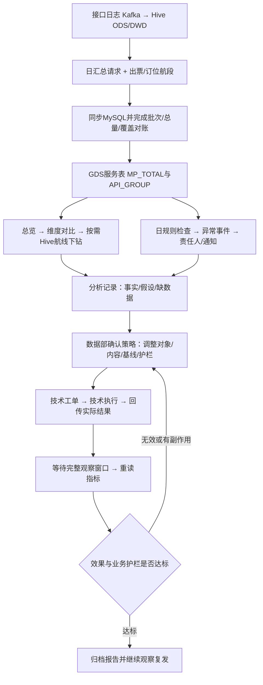

# GDS资源治理业务闭环复评 V3

- 日期：2026-10-20；负责人：数据部马远尔。
- 状态：业务方向已确认，细节继续共同梳理。本轮为代码审查与方案文档，不执行业务开发、DDL、调度和生产控制。
- 本次确认：先完成人工闭环；首份复盘回答“白名单缩减、增加MPIS后，查定比为何反而升高”。
- 证据：应用`data_report`基线`b1306aa`，独立ETL仓库代码；本轮未查询生产库，表存在性、部署和实际调度需另验。
- 与[PRD V2](gds-resource-governance-prd-v2.md)关系：保留已有实现，修正能力边界；本文件新增设计未确认和实施前，不自动替代现行流程。

## 1. 最终要解决什么

既要满足GDS指标要求、减少无效查询，又要保护有效航段与业务产出。闭环不是“查定比超标后发群消息”，也不是“工单点了成功”；必须能回答：异常来自哪里，为什么调整，技术实际改了什么，何时生效，结果是否改善，是否需要恢复或再调整。

当前公司正式分析口径：

```text
Q = 非 *_MPIS 的查询请求量（含NDC）
S = 出票航段 seg_num（flag=1，历史NULL暂按1；flag=0另作订位分析）
查定比 R = SUM(Q) / SUM(S)
MPIS占比 = MPIS查询量 /（普通MP + NDC + MPIS查询量）
```

1A当前内部治理目标为4000:1，各GDS应独立确认。外部合同考核范围、期间和口径仍需书面核对。日内/日指标用于诊断，月考核要使用月累计分子分母重算。

“超额查询=max(Q−目标×S,0)”是相对目标的测算，不证明这些查询均无效。OTA只分析查询/验价/生单质量，不套用GDS比率。

## 2. 当前真实能力与缺口

| 环节 | 代码核对结果 | 尚未形成的证据/能力 |
|---|---|---|
| 数据读取与清洗 | 两张MySQL上游表生成`bi_gds_resource_metric_day`；航段先聚合；以两源键并集保存记录 | 两源批次完整证明、覆盖对账；当前仅按当日航段是否有记录判断缺行能否记0 |
| 总览与下钻 | GDS、PCC、平台、站点、接口组分析；Hive航线查询/验价/生单质量 | 航线没有航段分母、标准错误码/原因；Top500不能代表全量 |
| 日异常 | `monitor_resource_governance_daily.py`读取规则版本并落事件、通知 | 仅GDS日查定比和OTA日成功率模板；GDS接口质量/航线规则不是已通用支持 |
| 人工处理 | 监控中心服务端支持确认、观察、结论与日志 | 需本轮业务验收角色、日志、观察到期行为 |
| 执行与回传 | 正式监控中心支持人工建工单、接单、执行/失败/恢复回填 | 技术系统自动消费、纯表回执与消费任务未闭环 |
| 白名单/配置/复盘 | 新治理页面包含localStorage演示 | 无真实版本快照、策略变更记录、效果数据，不可据演示判断已执行 |
| 调整效果 | 总览可查前后趋势与导出 | 无变更范围基线、可比窗口、影响拆解、效果结论和护栏 |

因此：已有真实日监控与人工工单能力；“读取→分析→策略→生产执行→效果复盘”整体仍需补齐。不能把能演示的流程视为生产闭环。

## 3. 目标链路与每步产物



数据不完整时进入“待补数据/重新检查”，不能进入下线建议。通知失败只重试发送，不重复建异常；技术失败保留工单与原因；到期只是“待恢复”，实际恢复必须有技术回执。

## 4. 数据读取与清洗

### 4.1 复用现有数据

| 数据 | 来源/处理 | 当前落点/用途 |
|---|---|---|
| GDS/OTA请求 | ODS→5分钟DWD→DWS/ADS→MySQL同步；上游调度由数据团队负责 | `sibebid.bi_ota_gds_request_day` |
| 出票/订位航段 | 业务航段清洗并按配置归属汇总 | `sibebid.bi_issue_segment_pnr_year`，`flag`区分 |
| GDS服务指标 | `bi_gds_resource_metric_day_etl.py` | `MP_TOTAL`用于Q/S；`API_GROUP`用于分组质量 |
| 航线质量 | 有条件时读Hive分区`dt`，不全量搬进MySQL | `lywz.dws_gds_airroute_day` |
| 白名单 | 现有`api_global_valid_route`与未来版本记录 | 实际读取方式、字段及`status=1`语义待核验 |
| MPIS命中/回退 | 旧日报参考`dws_gds_mpis_interval_rate_all`、`bi_gds_mpis_interval_rate_day` | 数据可用性、粒度与是否含回退需核实，不能假定具备 |

ODS/DWD历史保留短，缺失历史错误明细不能靠页面补回。高基数航线/人数/去回程组合按需求访问Hive或做限定日汇总，不扩到总览服务表里。

### 4.2 清洗和质量约束

- 两源分别按日期+平台+站点+GDS+PCC聚合；服务表使用两边键并集，避免丢请求独有/航段独有组合；接口组明细不重复分摊航段。
- `MP_TOTAL`和`API_GROUP`不相加；比率和成功率统一从基础量重算。
- 输出源同步时间、服务表清洗时间；未来增加批次状态/业务日完成证明，而不是靠某个MAX时间代表全部完成。
- 当前ETL当日有任意航段记录就把细分缺行当0，这是兼容策略，不能识别部分平台/PCC未同步。先对账，再决定是否沿用或补覆盖检查。
- 对账最少包括请求基础量、航段基础量、重复键、空键、日期覆盖、无请求航段和无航段请求组合。异常时保留诊断，不能默默删记录。
- 订位`flag=0`用于解释配置入口与出票归属差异；日汇总只能看分布。要证明“从A订位、改到B出票”，需订单/PNR/航段稳定键和两个配置及时间的关联明细。
- 日治理只处理昨日及以前完成批次。不得用日表验收一小时或四小时封禁效果；小时/更细数据未准备前保持人工观察。

### 4.3 已识别的实现风险，后续任务逐项验证

1. 展示治理目标来自应用配置，日规则阈值来自规则版本，两者可能不同。先标来源，后续统一有效期和版本。
2. 当前日规则查定比读`MP_TOTAL`，其中`source_api_group`固定为`MP_TOTAL`；若配置具体`1A_NDC`筛选，可能查不到数据，不能以该分组套总航段算查定比。
3. 分组日检查当前最多取500组；超过后需明确截断或分页处理，不能以运行成功宣称检查全部对象。
4. 同规则版本/日期/对象重跑更新现有事件证据，不保留不可变首发快照；复盘应保存分析/策略基线。
5. `--no-notify`仍落事件；随后正式重跑现有事件当前不会补发首条通知。静默验收需隔离对象，正式补发流程单独验证。
6. Hive航线按请求量截断，摘要与列表统计范围不同；Top名单不代表已覆盖全部低量高失败航线。

这些是本轮代码发现，不在本轮直接修改。

## 5. 第一份真实分析怎么做

### 5.1 明确变更，不从结果倒推故事

用户本轮确认调整涉及**2026-10-17**；航线白名单原允许16000多条，移除约10000条、剩约6000多条，**26小时逐步生效**，影响传导至各汇总维度。17日是开始还是全部完成尚待确认；MPIS调整是否同一窗口也需核实。条目数量是近似业务描述，后续按白名单唯一键核对，不能假定等于去重航线数。

时间分三段：调整开始前、26小时过渡期、全部生效后。过渡期单独观察，不归入稳定事后样本；如果某日混合旧新配置，日表无法把这一天精确拆开，需小时数据，或从全部生效后的下一个完整日开始。此前按一次切换暂列18/19日的事后窗口已撤销，必须等待实际起止确定后重选。截至20日不保证已具备足够事后样本，不比较长短不同窗口的累计量或声称稳定效果。

首份报告分两层：

- 总体层：同范围GDS/PCC/平台的Q、S、R和MPIS变化，判断整体是否达标。
- 航线层：按调整前后真实清单区分保留、移除、新增/其他变化的条目，比较流量贡献、残留请求和三阶段质量；无快照时先重建清单，不能从当前白名单反推历史状态。

移除约六成条目不代表削减六成请求；要看被移除条目在调整前实际承载的请求量。各汇总维度受影响也不代表每个PCC/平台等幅下降。保留航线可能承接转移流量或同时发生MPIS调整，不能自动作为未受影响的对照组。MPIS迁移需同时看绝对请求、命中、失败/回退和出票航段；同窗多个动作先合并观察，缺少证据时不声称已拆出单项因果效果。

26小时过渡期结束需以技术实际生效证据为准；原因可能涉及发布或配置刷新，但当前没有证据，不自行归因缓存。后续最好保留实际配置版本与生效时间，数据粒度不够时只报告日级观察。

登记白名单缩减、MPIS新增的实际时间、GDS/PCC/平台范围、删改/新增内容、技术实际生效时间。无历史快照时允许人工重建变更清单，标记“人工回忆/近似时间”，不声称精确归因。

先取变更前后相同数量的完整业务日，优先比较同星期，并拆出变更当天这个混合窗口。7天前后可作为建议起点，最终依实际日期、可用历史和业务活动确认。样本少或有节假日/促销时，在结论里保留限制。

### 5.2 必须观察的指标

| 业务变化/问题 | 同时观察什么 | 需要排除什么 |
|---|---|---|
| 白名单从多变少 | 总请求、MP/NDC/MPIS绝对量，保留/移除/新增航线各自流量及质量 | 低量航线被删不一定降总量；剩余热航线重试或流量集中 |
| MPIS配置增加 | 实际MPIS请求量、占比、配置命中、MPIS失败及回退MP量 | 配置数量增加不等于流量迁移；MPIS失败可能再发MP |
| 查定比升高 | 分子Q变化、分母S变化、同范围R变化 | 航段延迟同步、航段下降更快、请求/出票归属不一致 |
| 某PCC超标 | 该PCC请求与出票航段、订位/出票配置分布 | 不能因出票转到别的PCC就断定该入口无产出 |
| 失败增加 | 查询/验价/生单分别的量与成功率、超时/耗时/变价、错误分类 | 不用不同接口累计量当一批请求的漏斗 |
| 总体改进但局部变差 | 平台/PCC/接口组/航线结构与同范围趋势 | 结构变化可能掩盖原组合恶化；不平均局部比率 |

航线无分母时，先用请求贡献、失败量和质量定位，不能给航线算正式查定比或据此自动封禁。

### 5.3 一个解释反升的例子（假数据）

| 期间 | MP查询量 | 出票航段 | 查定比 |
|---|---:|---:|---:|
| 调整前 | 64,000,000 | 16,000 | 4,000 |
| 调整后 | 52,000,000 | 10,000 | 5,200 |

查询量减少18.75%，航段减少37.5%，比率反升30%。这只能说明分母降得更快，不能直接判定白名单调整导致丢单。

进一步可按固定顺序精确拆解：

```text
查询变化影响 = (Q后−Q前)/S前 = −750
航段变化影响 = Q后×(1/S后−1/S前) = +1950
比率总变化 = −750+1950 = +1200
```

只在两期S均大于0且范围可比时使用，并在报告写明拆解顺序；它是数学贡献，不是因果证明。

### 5.4 报告最小交付

变更登记 → 数据质量与对账 → 总量前后对比 → 分子/分母拆解 → 维度及航线证据 → 已证实/待验证假设 → 建议小范围策略 → 观察指标和退出条件。

没有补齐回退、错误原因和订单配置链路时，可以先出“观察报告”，明确哪些假设无法证实；不把空字段当0，不用虚构数据补结论。

## 6. 异常、策略、执行和复盘怎样衔接

| 阶段 | 业务输入与责任人 | 系统记录/输出 | 进入下一步的条件 |
|---|---|---|---|
| 异常收集 | 完整日数据+规则；系统每日检查 | 现有`monitor_alert_event`，保存规则版本、范围、实际值、阈值、负责人 | 数据可用且命中；不是直接授权下线 |
| 问题分析 | 数据分析人员核对总览、分组和航线 | 建议新增分析记录：关联事件、查询范围、数据批次、事实、假设和缺口 | 数据部确认原因证据或明确“试验性调整” |
| 策略确认 | 数据部选择观察/缩白名单/调MPIS/限流/下线等 | 建议新增策略记录：目标对象、调整前后值、预期、护栏、计划窗口、负责人、回退 | 目标键可执行、基线齐全、权限满足 |
| 技术执行 | 技术读取已确认工单 | 复用`monitor_resource_action_order`；返回接单、成功/失败、真实时间、执行版本/流水号 | 有真实成功回执才认为生效；新增动作类型需另设计 |
| 观察 | 数据部按实际生效时间选择完整窗口 | 保存基线和观察期，重读相同范围指标 | 批次完成、观察窗足够，未触碰护栏 |
| 复盘 | 数据部评估，业务核对影响 | 建议保存结论：有效/无效/副作用/数据不足，指标证据和下一步 | 真实改善后业务关闭；失败/不足回分析或策略 |

“白名单缩减”和“流量转MPIS”目前不是正式工单中已支持的动作，不能塞进现有下线字段假装技术可直接消费。可先人工记录变更，再确认动作合同后扩展。

现有工单技术恢复时会将事件置为已解决；这只是操作层结束。后续效果验收必须独立保存，页面应区分“处置完成”和“效果已验证”。

外部技术只消费已批准指令，不能按异常标签直接执行。目标键至少区分对象类型、GDS、PCC、平台/站点、API组、航线城市/机场粒度及配置ID/版本；哪些字段必填由具体动作决定。整个配置、单航线和单人数/日期组合不能互相替代。

## 7. 页面收敛与表设计边界

继续复用现有一级“资源治理”，不再新增平行模块：

| 入口 | 内容与定位 | 接真数据的策略 |
|---|---|---|
| GDS资源治理 | 总览、趋势、维度分析、月目标与日异常入口 | 复用现有服务表/API |
| OTA渠道质量 | OTA三个接口质量，独立目标 | 复用现有日表/API |
| 航线/配置诊断 | 带条件看三阶段质量；未来再补配置/MPIS和错误原因 | Hive按需查询；已有配置样板标清演示 |
| 白名单与变更 | 最新有效范围、版本差异、关联策略 | 当前演示，需确定源数据和版本采集 |
| 治理执行 | 从资源上下文进入正式事件/工单 | 复用监控中心真实记录，逐步替换localStorage演示 |
| 治理复盘 | 变更前后对比、效果证据、经理摘要 | 先真实报告，再决定页面；不先堆图表 |

表的分工：事实表只存基础量；配置/规则表存政策；事件表存检测结果；策略/变更记录存人工决定；工单/回执存实际执行；复盘存评价依据。首版复用所有现有监控表，分析、策略、快照、回执和复盘的新增表只在字段与粒度确认后出DDL。本轮不要求重建现有表。

后续API应按上述对象分别设计：分析查询、分析记录、策略草稿/提交、技术工单与回执、效果对比。每个接口明确参数、状态、版本、权限、分页、质量状态及错误响应；沿用现有`/api/v1/resource-governance/...`和监控中心接口，未确认的新路由不写成可调用接口。

## 8. 分阶段推进与验收

| 顺序 | 交付 | 验收/下一步门槛 |
|---|---|---|
| P0-1 | 明确变更时间/范围及当前指标契约，核验请求/航段同步和服务表 | 同日同范围两源与服务表一致；NULL/0/未同步可区分 |
| P0-2 | 第一份真实调整观察报告 | 能解释Q和S分别如何变，列出无法证实的假设；不先认定原因 |
| P1-1 | 一条人工闭环：事件→分析→策略→技术回传→效果 | 重复操作不重复执行；日志完整；技术失败与观察延后可处理；效果不被工单状态替代 |
| P1-2 | 补白名单版本、MPIS质量/回退、错误原因和必要配置链路 | 粒度/保留期/责任人确定；报告关键缺口能被数据验证 |
| P2 | 接真实变更与复盘页面，再试点自动标签 | 与真实报告对得上；复用监控流程，不创建第二套事件 |
| P3 | 小范围自动上下线 | 执行范围精确、数据时效足够、回执幂等、回滚护栏和人工接管均验收 |

日级数据可支持日异常判断，暂不支撑“第一次封1小时、第二次4小时”的自动效果判断。短窗口治理需要后续小时/分钟数据完成与同粒度业务产出；该数据依赖优先于自动封禁。

## 9. 现在需要用户配合什么

按顺序补，不要求一次准备全部：

1. 已确认涉及2026-10-17且26小时渐进生效；继续补开始/全生效时刻、移除/保留清单，以及MPIS是否同窗变化、GDS/PCC/平台作用范围。技术记录、配置清单或人工说明均可，标明准确程度。这是第一份真实报告最先需要的输入。
2. 两张MySQL上游及服务表可用日期、更新/完成方式；后续只读验数时再提供连接授权或执行SQL结果，不在文档保存凭据。
3. 当前有效白名单字段/状态/唯一键，MPIS实际命中/失败/回退是否有表；能复用先复用，没有再给最小新增采集字段。
4. 技术实际调整对象键、回传格式和执行时间；先人工记录也可，不强制本轮建表。
5. 数据部确认观察窗口和业务护栏，外部考核口径向相关负责人核实。未确认前报告展示变化，不自动执行惩罚。

下一次讨论先回答第1项，再取真实数据做分析；报告得出需要哪些新字段后，才把DDL、ETL、API与页面的开发清单逐项定下来。
