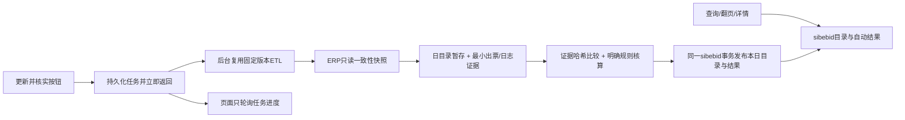

# 自动风控核实V1：产品提示词与验收契约

来源：2026-11-04用户明确要求“自动核实，通过后人工抽查；不同类型只看相关详情”，并确认本案例利润字段为“出票利润”。状态：授权开发，不代表实单已验收。

## 产品提示词（本项目业务版本）

```text
为数据中台开发自动风控核实：系统按已确认规则自动取证、计算、给结论并留痕，人工只抽查通过单、处理异常和证据不足。不要以人工确认数量作为自动核实进度。

主链路：出票日目录 → 按原因类型选择规则 → 自动读取必要证据 → 确定性核算 → 通过/有问题/证据不足/执行失败；规则未配置单独列示。详情按类型显示必要字段、来源、计算、结论及原因，默认不展示全订单、原始JSON、无关日志、知识发布或模型调试。

首版仅启用RLA013，平台去哪儿且该票有正销售佣金。用户已确认单票利润使用出票利润issue_profit；加回该票sale_commission_amount，与负日志止损值按>=比较，等号通过。出票利润为CNY，佣金只有明确CNY时执行。该订单止损片段须完整且金额自洽，只有一个一致止损值时逐票使用；不能按日志条数与票数配对，出现冲突不自动放行。订单有多票须逐票核实：全部符合才订单通过，有明确不符则有问题，并列出未核实部分；证据不足、执行失败和未接规则绝不当通过。

已有确定规则不依赖AI。AI后续仅解释不明确证据、检索已确认知识或提出待核实假设，不能自行定规则或把猜测转为通过。执行无需真实模型外发。

页面按出票日期汇总自动状态，点击下钻；进入页面、查询、切换日期、翻页和查看详情只读已保存数据，不启动ERP读取或后台任务。只有点击“更新并核实”才提交所选日期到有界后台任务：同步目录、在同一源快照读取必要证据、核算并按日原子发布。显示阶段和进度，失败不循环重试。保留人工抽查，抽查结论不能覆盖自动计算记录，均关联证据/规则版本和操作者。保持现有管理员及个人结果隔离，不新增团队权限。
```

## 最小范围与边界

- 首单目标：用户提供数值-61.19+16.78=-44.41，边界-50，满足条件时系统核实通过；-50通过、-51不通过。真实字段齐全与实单运行仍须验收，不硬编码案例或金额。
- 其他类型展示规则未接入，不套用佣金规则。原人工案例、知识及确认历史保留；新默认抽屉仅显示自动核实相关内容。
- 原订单目录与字典继续来自sibebid；ERP取证只在后台/单订单重核，列表GET不扫描ERP。任务持久化、同账号活动任务去重，工作进程中断要可显示失败并重试，不伪报完成。
- 每次按钮更新1—31天，最多2000个已接规则的去重订单；超限明确失败，建议缩小日期，不截断冒充完成。每个日期独立成功发布，后续日期失败不撤销前日已成功批次；界面显示失败和各日数据截止时间。未知类型只刷新目录，保持规则未接入。
- 抽查按结果版本记录“确认无误/发现问题”及说明，自动结论保留。每次按钮操作重新读取出票、佣金与必要日志，即使主单更新时间未变也比较完整最小证据哈希；哈希及规则均未变才复用旧计算。目录批次改变或新刷新请求使旧结果过期，失败时不能继续计为当前通过。查询不检测ERP变化。
- 生产数据、模型、部署、调度与业务验收分别报告。本地金额/权限/任务状态/失败/抽查回归必须使用合成源，不在生产试错。


## 2026-11-04修订：手动触发与MySQL存储

本节替代原查询自动触发及SQLite自动结果存储设计，规则金额与人工抽查口径不变。当前账号的活动任务由数据库唯一约束去重；刷新开始后后续查询仍只读，不等待后台任务完成，失败后由用户排查并再次点击。任务中断超过10分钟无心跳显示失败，不自动续跑。



- 数据源：ERP `order_info`、`order_info_issue`、`order_info_operator_log`，字典 `system_com_type_det`。目录与字典仍为sibebid原四表；自动任务、核实结果和抽查改存 `bi_risk_auto_jobs/results/samples`，建表SQL为 `docs/sql/risk-auto-mysql-v1.sql`。应用不会自动建表，也不回退SQLite。
- 后台代码复用独立ETL的固定版本生成快照，不通过SSH调用216。导出入口 `scripts/sync_risk_etl_snapshot.py`，来源提交及SHA256记在生成模块的meta.json；修ETL后须重新导出，不双份手改。独立216 CLI不传扩展hook时行为保持不变。
- 无定时调度；原216脚本仍可独立运行，但外部同步会使对应旧自动结果过期，需按钮重新核实。没有声称现有五分钟调度已配置。
- 当前仅管理员访问，结果/任务/抽查按账号隔离。ERP保持只读；应用连接sibebid须有原目录四表及新自动三表必要读写权限、临时表权限。部署人单独审批/执行DDL与权限；不修改公共DataSource、公共连接配置、SQL源表索引或生产配置。
- 存量SQLite只作为旧人工历史和迁移源保留；只迁移auto_*三张旧表。明确停写、备份、全事务逐字段核对后才切换，冲突停止，禁止清库。操作见开发交付文档。本机替身验证不证明247真实权限、驱动、DDL或耗时通过。
